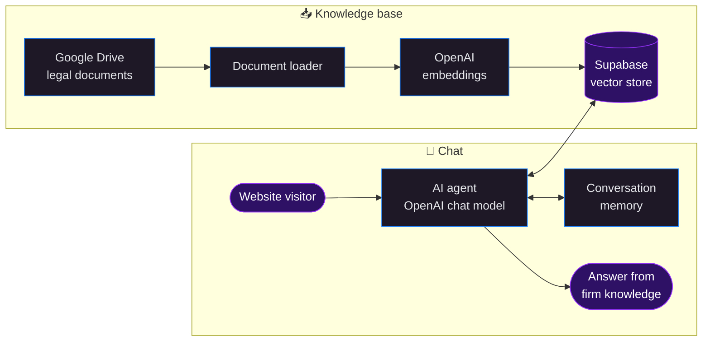

<!-- styled:v2 -->

**An n8n chatbot for law firm websites that answers client questions from the firm's own legal knowledge base, using retrieval-augmented generation (RAG).**

  
  
  
  
  

  <a href="#overview">Overview</a> ·
  <a href="#how-it-works">How it works</a> ·
  <a href="#key-features">Key features</a> ·
  <a href="#tech-stack">Tech stack</a>

---

## Overview

Law firms answer the same questions again and again, and a static website can't reply in real time. This chatbot sits on the firm's website and answers from the firm's own documents, so replies stay accurate, consistent and on-brand, 24 hours a day.

## The challenge

Repetitive client questions take up staff time, replies are slow and inconsistent, and website visitors leave before anyone responds.

## How it works

1. **Documents loaded.** Legal documents from Google Drive are split, embedded with OpenAI and stored in a Supabase vector store.
2. **Question received.** A visitor asks a question in the website chat.
3. **Knowledge retrieved.** The AI agent searches the vector store for the most relevant passages and keeps the conversation in memory.
4. **Answer sent.** It replies in a professional tone using the firm's own information.

## Key features

- RAG answers grounded in the firm's knowledge base
- Covers criminal, civil, FIA, intellectual property, tort and defamation questions
- Conversation memory for follow-up questions
- Available 24/7 on the firm's website
- Knowledge base refreshed by re-running the Google Drive ingestion

## Use cases

- Law firm websites
- Legal consultation platforms
- AI client intake and support

## Tech stack

    

## Files

| File | Contents |
|:--|:--|
| `legal chatbot (2).json` | The n8n workflow: import it into n8n and add your own credentials |
| `AI-Powered Legal Chatbot for Law Firm Website.docx` | Project write-up |

## Demo

▶️ [Watch the demo video](https://drive.google.com/file/d/1fqKHOb_AOZ-gb79qFqd6NwznNGMe_k2R/view?usp=sharing)

> The chatbot gives general legal information only and does not replace professional legal advice.

---

**Built by [Ch Muhammad Samiullah](https://github.com/samiullah156-creator)** · AI Automation Engineer and Full-Stack Developer at [Lexvaxa](https://lexvaxa.com)

⭐ Star this repo if you found it useful

